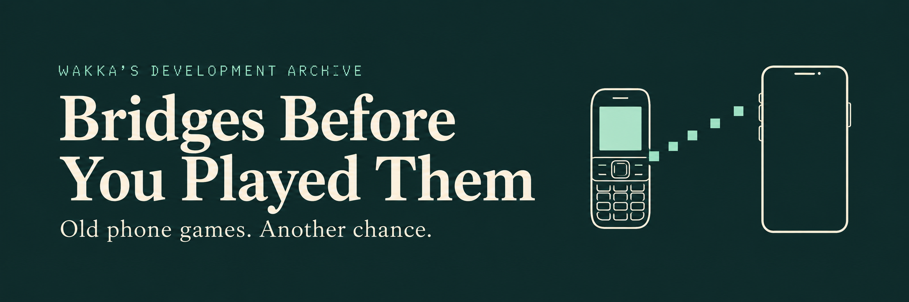

The failed builds. The strange fixes. The moment an old phone game starts doing what it used to do.

I’m Wakka. This is a director’s cut of the work behind my Android game bridges: **52 game histories, one LEGION essay, 533 receipts and 59 historical images.** Edition 1.1 · October 2026.

I wanted these games back on my phone. A bridge gives an original game the runtime, graphics, sound and controls it needs on Android. [Omni Player](https://github.com/Wakkatobakka/Omni-Player) brings the bridges together in one app; players supply the original game files.

## Inside the archive

Snowboarding put me inside Cloud’s chest before we got him recognizable—and upside down. Resident Evil 4 let me run around as a gun with no visible Leon. Ashen kept sliding after I released the controls, until we followed the problem down to the runtime clock.

Those are some of the stories here. There’s a searchable game index, original screenshots, selected development records and expandable receipts. The LEGION essay follows the fixes and discoveries we could carry from one game into another.

Each chapter covers a particular window in the work. A failure in an old checkpoint doesn’t tell you the status of the latest release. Current downloads, installation and play information live with Omni Player.

## How we worked

I bring the ideas and constraints, test on my phone, and direct the next attempt. ChatGPT helps investigate failures and implement changes. We assembled this archive from the saved reports, checkpoints and my memories, checking the published excerpts against their sources.

Original games, translations, upstream runtimes and tools keep their own credit. The English Lost Episode patch is credited to **TurquoiseHammer / Yuvi**. Individual chapters identify the software and translation work involved.

## About the record

The archive contains the written stories, reviewed text excerpts and labeled historical imagery. Original game packages, firmware, prepared game executables, private bridge implementation, checkpoints, build tools and signing material are excluded. This archive does not grant a license to the original games or private bridge implementation.

The [editorial method](EDITORIAL_METHOD.md) explains how we handled quotations, source excerpts, historical images and test results.
